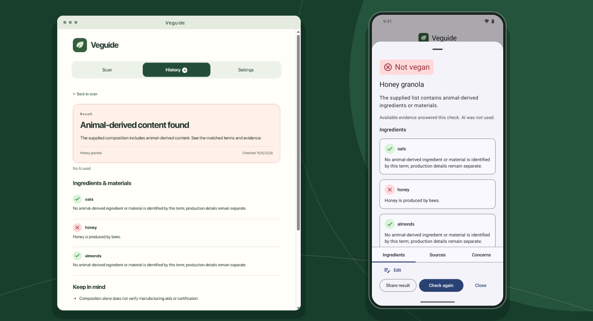
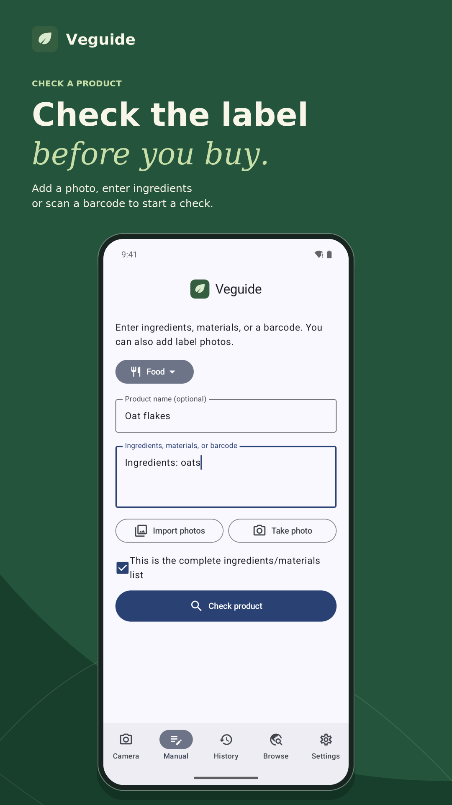
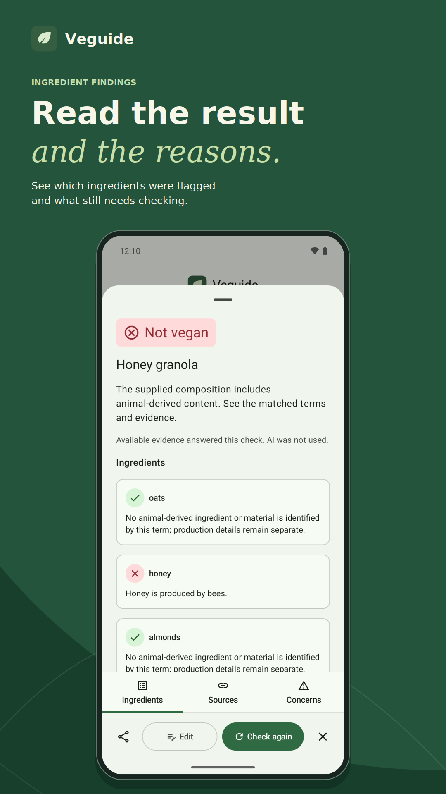
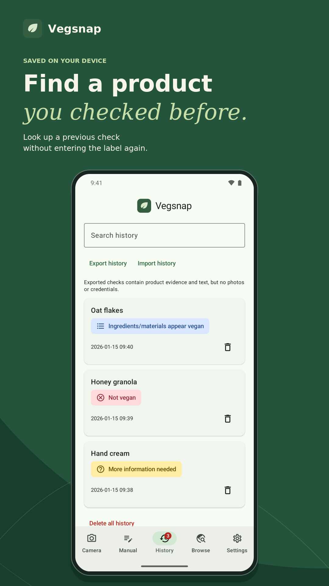
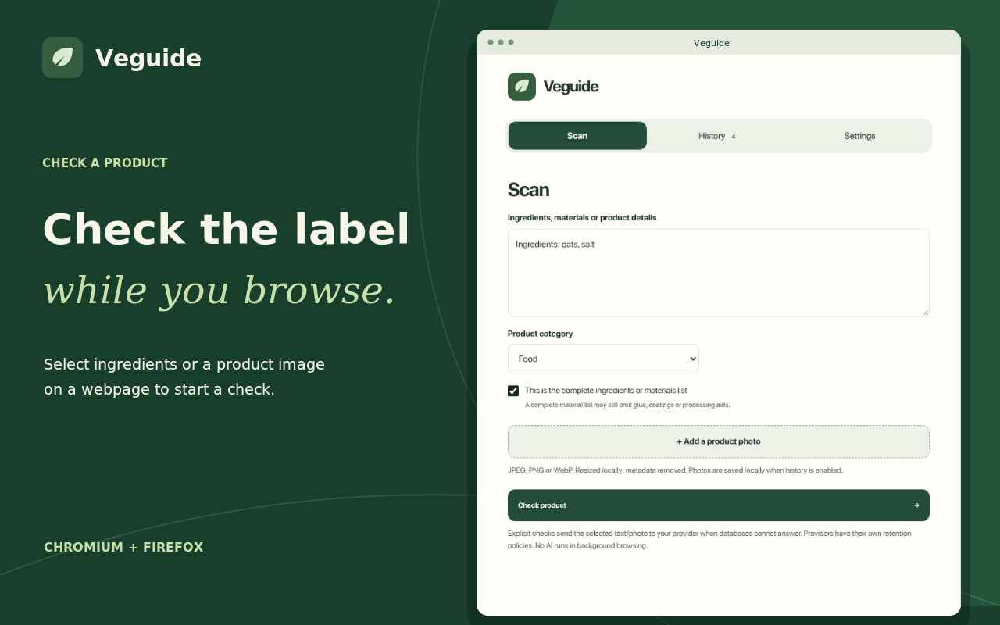
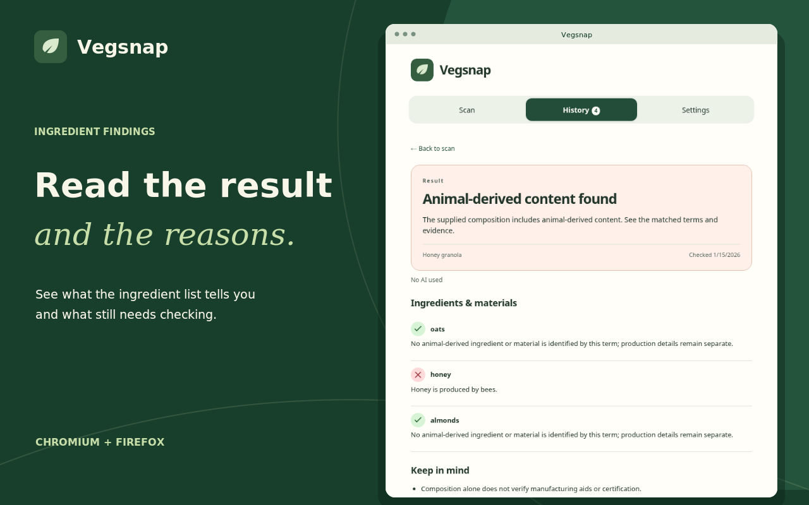
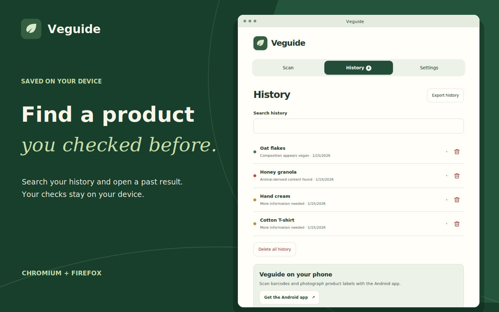

  <picture></picture>
  <h1>Vegsnap</h1>
  
<strong>Check whether a product appears vegan.</strong>

  
Photograph a label on Android, or check ingredients and product images in Chromium or Firefox.

  

    <picture></picture>
    &nbsp;&nbsp;
    <picture></picture>
    &nbsp;&nbsp;
    <picture></picture>
  

  
<picture><source media="(prefers-color-scheme: dark)" srcset="website/images/dark/readme-preview.png"></picture>

  

    
    
    
     
    
  

  

    

Vegsnap supports food, cosmetics, household products, clothing and shoes. It uses public product databases, local ingredient and material rules, and optional AI. Results show the evidence and explain which details are missing.

You do not need a Vegsnap account. History stays on your device. The app has no ads or telemetry.

You can look up reviewed manufacturer replies in the Android app or open the community service from the extension. To contribute a reply, open the submission form and redact personal details before sending it. The [community service](packages/community/README.md) publishes approved contributions on Cloudflare. Opening a product automatically looks up reviewed replies using its barcode, name, brand and country. Matching whole-product confirmations can change the displayed verdict; ingredient-only replies cannot. Conflicting evidence is shown explicitly. Your saved scan, history and photos stay on your device. Replies can cover several products or a reviewed product range. Android offline mode disables lookup; Firefox requires its data-sharing permission.

This is an early release. Device, store and provider compatibility tests are ongoing.

## What it does

- On Android, take or import photos, share a product, or enter text. The app has local history and offline text recognition with downloadable language models.
- In Chrome, Chromium, Brave, Helium, Vivaldi, Microsoft Edge, Firefox, Zen and LibreWolf, check selected text or right-click a product image. Enable store integrations if you want database checks while browsing. Background checks never use AI. Export your history as JSON and import it in another browser or on your phone.
- Use Vegsnap AI for limited free checks without a subscription or API key. You can also connect ChatGPT with a Plus or Pro plan, an OpenAI-compatible API, or a compatible local model. Only ChatGPT sign-in in the extension needs the desktop companion.
- Look up barcodes in Open Food Facts, Open Beauty Facts and Open Products Facts, or browse these databases by product name or brand. Regional packs for Germany, Sweden, the EU, the United Kingdom, Ireland, Austria, Switzerland, France, Belgium, the Netherlands, Spain, Italy, Norway, Denmark, Finland, the United States, Canada and Australia provide a selection of these records offline, including for browsing. A weekly workflow rebuilds them from the public exports. Each pack holds up to 40,000 products (20 MB). The [regional product packs release](https://github.com/D3SOX/vegsnap/releases/tag/offline-data) holds the catalog, and each quarter's packs go into a separate release.
- Find similar vegan alternatives from non-vegan results, or start a general search from Browse on iOS, Android and in the extension. Enter an optional store name to prioritize products recorded there. Public vegan-labeled records come first; connected AI with web search adds sourced suggestions. Store listings suggest availability, not current branch stock. Review the source and current package. Alternative search needs internet access; AI research uses the connected provider’s allowance.
- When AI finds a manufacturer contact, draft a question in English, German or Swedish. Copy it or open an email draft to ask about missing product details.
- Review company concerns alongside the product result. A reviewed list records documented animal testing, opposition to animal-welfare protections and other animal exploitation. Each entry has a source, a review date and a status. Parent-company links need their own ownership source. Selling animal products alone does not qualify.

Connected AI can also assess a company using searched sources. Its assessment stays separate from reviewed records and can be inconclusive. Neither changes the product's vegan result. A missing record or no concerns found is not an ethical endorsement.

English, German and Swedish are supported, with Germany and the EU as the first markets. Local ingredient rules also read French, Spanish, Italian, Dutch, Norwegian, Danish and Finnish labels. A native SwiftUI app for iPhone and iPad is available in [ios/](ios/). Releases include `vegsnap-unsigned.ipa`. It must be signed before installation, including the embedded share extension and its App Group entitlement.

## Screenshots

### Android

  <a href="website/images/screenshots/android-check.png"><picture><source media="(prefers-color-scheme: dark)" srcset="website/images/dark/store/android/check-portrait.png"></picture></a>
  <a href="website/images/screenshots/android-result.png"><picture><source media="(prefers-color-scheme: dark)" srcset="website/images/dark/store/android/result-portrait.png"></picture></a>
  <a href="website/images/screenshots/android-history.png"><picture><source media="(prefers-color-scheme: dark)" srcset="website/images/dark/store/android/history-portrait.png"></picture></a>

### Browser extension

  <a href="website/images/screenshots/extension-check.png"><picture><source media="(prefers-color-scheme: dark)" srcset="website/images/dark/store/extension/check.png"></picture></a>

  <a href="website/images/screenshots/extension-result.png"><picture><source media="(prefers-color-scheme: dark)" srcset="website/images/dark/store/extension/result.png"></picture></a>
  <a href="website/images/screenshots/extension-history.png"><picture><source media="(prefers-color-scheme: dark)" srcset="website/images/dark/store/extension/history.png"></picture></a>

Open an image to see the original screenshot.

## AI and evidence

For free AI checks, choose **Vegsnap AI** in Settings, select **Connect to free AI** and complete verification in your browser. Return to Vegsnap to see your remaining allowance. This connection needs no ChatGPT subscription, personal API key or desktop companion. Access expires after 24 hours and allowances reset at midnight UTC. A shared service limit can make free checks unavailable. A failed check counts against your allowance only if OpenAI had already returned a response.

Product checks have a request limit per verified installation, so users sharing a mobile network or Wi-Fi connection have separate limits. A broader IP limit protects connection setup and other service requests, and each IP address can verify up to five connections per day. Temporary throttling asks you to wait a minute; exhausted daily allowances reset at midnight UTC. Up to three photos sent together count as one check.

Vegsnap AI sends selected product text, prepared photos and product details through a maintainer-operated Cloudflare service to OpenAI. It does not send your saved history or personal provider credentials. See the [privacy policy](https://vegsnap.app/privacy.html) for storage and retention details.

ChatGPT sign-in on Android and in the browser extension requires a [ChatGPT Plus or Pro plan](https://developers.openai.com/siwc/quickstart). Free ChatGPT accounts are not supported for this connection. Android connects directly; the extension needs the desktop companion. Both support saving, switching and removing ChatGPT accounts in Settings, and prefer `gpt-6-luna` when available unless you select another model. Update the desktop companion to use account management in the extension. Switching reconnects the selected account through browser sign-in; disconnecting keeps saved accounts for later. Public database checks and local rules work without any AI connection.

AI can identify a product, read its label and assess unfamiliar ingredients. Vegsnap AI, ChatGPT and the official OpenAI API can also search for manufacturer and certification sources. Other compatible endpoints currently do not support web search.

Local models receive about 1,000 tokens of instructions. Long ingredient lists, photos and up to 100 ingredient assessments also need space, so set a context window of at least 8,000 tokens, for example with Ollama's `num_ctx`.

Vegsnap accepts a web claim only if its URL came from the search tool and its product and brand match the check. AI-read labels and claims remain marked unverified. Community database labels do not establish verified certification.

Incomplete composition, ambiguous ingredient origins or conflicting sources can produce an uncertain result. Automatic store database checks need an exact barcode from the listing. Use a right-click check when a listing does not supply one.

Connecting a cloud provider can send selected text and photos to that provider when you start a check. The provider's retention policy, usage limits and charges apply. Database checks and local rules need no AI account.

## Install the Android app

Download the signed APK using the Android badge above. You can also use the Obtainium badge to track updates.

To join the Google Play closed test, first [join the D3SOX apps testers group](https://groups.google.com/g/d3sox-apps-testers), then [opt in on Google Play](https://play.google.com/apps/testing/app.vegsnap) with the same Google account. Please stay opted in for at least 14 days, try the app and send feedback via [GitHub Issues](https://github.com/D3SOX/vegsnap/issues) or using the [contact on the website](https://vegsnap.app/#play-test).

Google Play and GitHub APKs use different signing keys. To switch between them, export your history, uninstall the current app and install the other version. Import your history and reconnect your AI provider. History exports do not include photos or credentials.

## Install the browser extension

Install Vegsnap from the [Chrome Web Store](https://chromewebstore.google.com/detail/vegsnap/pkkfmbgdbdoccbdngnbfpjjhpldmphej) in Chrome, Chromium, Brave, Helium, Vivaldi or Microsoft Edge. Install it from [Firefox Add-ons](https://addons.mozilla.org/addon/vegsnap/) in Firefox, Zen or LibreWolf based on Firefox 140 or later.

For manual installation, download the browser packages from the [latest release](https://github.com/D3SOX/vegsnap/releases/latest).

- Chrome, Chromium, Brave, Helium, Vivaldi and Microsoft Edge: extract `vegsnap-chromium.zip`, open `chrome://extensions` (`brave://extensions` in Brave, `helium://extensions` in Helium, `vivaldi://extensions` in Vivaldi or `edge://extensions` in Edge), enable developer mode and choose **Load unpacked**. Select the extracted folder. The release also includes `vegsnap-chromium.crx`, but some browsers restrict direct CRX installation. The ZIP works for development installation.
- Firefox, Zen and LibreWolf: download `vegsnap-firefox.xpi`, open `about:debugging`, choose **This Firefox**, then **Load Temporary Add-on** and select the file. The GitHub release XPI is unsigned and disappears when the browser closes. Use Firefox Add-ons for permanent installation and automatic updates.

## Install the ChatGPT companion

The desktop companion connects the browser extension to your ChatGPT Plus or Pro plan. Vegsnap AI, API-key connections and Android ChatGPT sign-in work without it. The companion saves credentials in your operating system's credential store.

Download the companion for your computer from the [latest release](https://github.com/D3SOX/vegsnap/releases/latest) and open it. Choose the browsers where you use Vegsnap, then select **Install**. Setup copies the companion into your user folder, so you can delete the download afterwards. It does not need administrator access. The companion supports Firefox, Zen, LibreWolf, Google Chrome, Chromium, Brave, Helium, Vivaldi and Microsoft Edge.

On Linux x86_64, download `vegsnap-companion-linux-x86_64.tar.gz`, extract it and open `vegsnap-companion`. ChatGPT credentials need an unlocked Secret Service wallet, such as KDE Wallet with Secret Service enabled.

On macOS, download `vegsnap-companion-macos-universal.tar.gz` and open **Vegsnap Companion**. It runs on Apple silicon and Intel. Apple has not notarized the app, so macOS may block it the first time. Choose **Open Anyway** in System Settings under Privacy & Security.

On Windows x86_64, download and open `vegsnap-companion-windows-x86_64.exe`. Microsoft Defender SmartScreen may warn about an unrecognized app. Choose **More info**, then **Run anyway**.

Then open the extension's settings, choose **Connect ChatGPT** and allow the native-messaging permission. Complete sign-in in the browser. To add a browser, update or uninstall, download the companion again and open it. Uninstalling keeps saved ChatGPT accounts in the credential store, so remove them in the extension's settings first.

### Registration details

Setup copies the companion to `~/.local/lib/vegsnap` on Linux, `~/Library/Application Support/Vegsnap` on macOS and `%LOCALAPPDATA%\Vegsnap\Companion` on Windows. For each selected browser, it writes the native-messaging manifest `org.vegsnap.companion.json` to that browser's per-user location. On Windows, it keeps the manifests under `%LOCALAPPDATA%\Vegsnap\NativeMessagingHosts` and registers them under `HKEY_CURRENT_USER`.

Brave on macOS and Brave, Helium and Vivaldi on Windows share Chrome's registration. Zen shares Firefox's location, as does LibreWolf on Windows. The manifests allow the Chrome Web Store extension `pkkfmbgdbdoccbdngnbfpjjhpldmphej`, the manually installed ZIP and CRX release packages `bljmddjdbglldnbdhdfdlbilieoheend` and the Firefox add-on `vegsnap@vegsnap.app`.

## Application strings

Edit `localization/strings.json` for Android, iOS, the iOS share extension, and the browser extension, including fixed result explanations and warnings. Each message contains English, German and Swedish translations and the platform keys that use it. Identical wording shares one entry; platform-specific instructions keep separate entries. iOS keys remain the existing English lookup keys, and Android keeps its existing resource names.

Run `bun run strings:generate` after editing the catalog. It generates Android `strings.xml` (including plurals), iOS `Localizable.strings`, and typed extension/core dictionaries. Android's result engine gets generated `ResultStrings` functions, which also work in plain JVM tests. Messages marked `savedResult` generate `data/result-translations.json` for displaying saved results in another language. Use the usual `R.string` / `stringResource`, `L(...)`, and generated dictionary lookups in application code. Generated files are checked in so native builds do not need an extra generation tool.

`bun run strings:check` verifies translations, formatting arguments, duplicate keys, and generated-file freshness; CI runs it as well. Add new interface and fixed result copy to the catalog instead of defining another bilingual dictionary or language branch. Ingredient rules, source evidence, and manufacturer-message templates remain in their existing shared data files.

## Data licenses

The application code uses AGPL-3.0-only. Open Food Facts, Open Beauty Facts and Open Products Facts databases use ODbL-1.0, with individual contents under DBCL-1.0. Regional packs retain source URLs and dates. These data licenses are separate from the application license.

Third-party dependencies, language models and certification marks retain their own licenses and terms.
